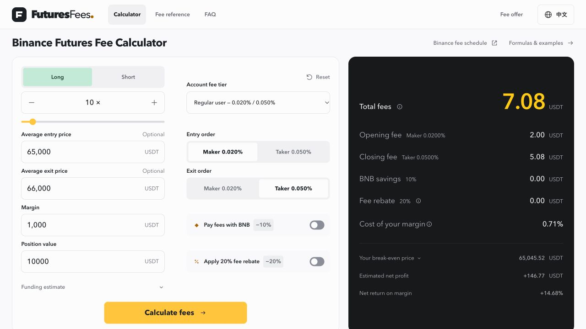

# FuturesFees — Binance Futures Fee Calculator

**English** · [简体中文](README.zh-CN.md)

Estimate opening and closing fees before comparing a futures trade's costs. [FuturesFees](https://futuresfees.com/) is a free browser-based calculator for Binance USDT-margined linear perpetual contracts, with separate maker/taker rates, optional funding estimates, net P&L and break-even calculations.

**[Open the calculator →](https://futuresfees.com/)** · [中文计算器](https://futuresfees.com/zh/)

No exchange account connection or API key is required. FuturesFees is an independent third-party project and is not operated by Binance. This repository introduces the product and contains its screenshots and usage guide.

*Illustrative inputs, not a live market quote or an account-specific fee statement.*

## What you can calculate

- Opening and closing commissions, with maker/taker roles selected separately.
- Single-side, round-trip and price-free fee estimates.
- Position value from margin and leverage, or margin from position value.
- Reference fee presets and custom account rates.
- Optional funding scenarios and conditional BNB/referral comparisons.
- Estimated net P&L, return on margin and break-even price when both prices are entered.

The interface is available in English and Simplified Chinese. Trade inputs are calculated locally in the browser; read the [privacy and project information](https://futuresfees.com/about.html) for website measurement and access-log details.

## A simple example: why closing fees differ

Assume **1,000 USDT margin**, **10× leverage**, an entry price of **65,000** and an exit price of **66,000**. Use a **0.020% opening maker rate** and **0.050% closing taker rate**, with funding, BNB savings and referral returns switched off. These are hypothetical assumptions.

| Item | Calculation | Estimated amount |
| --- | --- | --- |
| Opening position value | 1,000 × 10 | 10,000 USDT |
| Quantity | 10,000 ÷ 65,000 | ≈ 0.153846 |
| Opening fee | 10,000 × 0.020% | 2.00 USDT |
| Closing position value | (10,000 ÷ 65,000) × 66,000 | ≈ 10,153.85 USDT |
| Closing fee | Closing position value × 0.050% | ≈ 5.08 USDT |
| Total trading fees | Opening fee + closing fee | **≈ 7.08 USDT** |

The closing fee uses the value at exit. The calculator retains precision before rounding the displayed result. The [opening and closing fee guide](https://futuresfees.com/guides/fees.html) explains the formulas in more detail.

## How to use it

1. Open [FuturesFees](https://futuresfees.com/) and choose long or short.
2. Enter margin or position value and set leverage.
3. Enter the relevant average fill prices; select each side's maker/taker role and actual account rate.
4. Enable funding or conditional savings only when they apply to your scenario.
5. Compare fees and, with both prices entered, the estimated P&L and break-even result.

Use the commission rate shown in your own exchange account. Presets are reference assumptions, not an authenticated account lookup. A limit order does not guarantee maker execution. See the [leverage and trading-fee guide](https://futuresfees.com/guides/leverage.html) for the difference between margin and position value.

## Scope and disclosures

The calculator focuses on **USDT-margined linear perpetuals**. It does not execute orders, connect to your account or supply live market prices. It does not calculate spot fees, liquidation charges or slippage, and these formulas should not be reused unchanged for inverse coin-margined contracts or options.

Funding is separate from trading commission. Optional funding scenarios hold the entered rate and entry notional constant and cannot reproduce every actual settlement. Break-even is not a liquidation price or a forecast. Actual fills, exchange rounding and account conditions may change the final amounts.

The website contains affiliate registration links and its maintainer may earn a commission. Referral eligibility, rates and settlement depend on the exchange's current rules; a rebate is not necessarily an immediate fee reduction. Registration is not required to use the calculator.

Futures trading involves risk. This guide explains cost calculations and does not recommend trades or promise returns.

## Explore FuturesFees

- [English calculator](https://futuresfees.com/)
- [Simplified Chinese calculator](https://futuresfees.com/zh/)
- [Calculation methodology](https://futuresfees.com/methodology.html)
- [Educational guides](https://futuresfees.com/guides/)
- [About and privacy](https://futuresfees.com/about.html)

For a calculation issue, include reproducible example inputs and the expected result in a GitHub issue. Never post account credentials, API keys or private account records.
