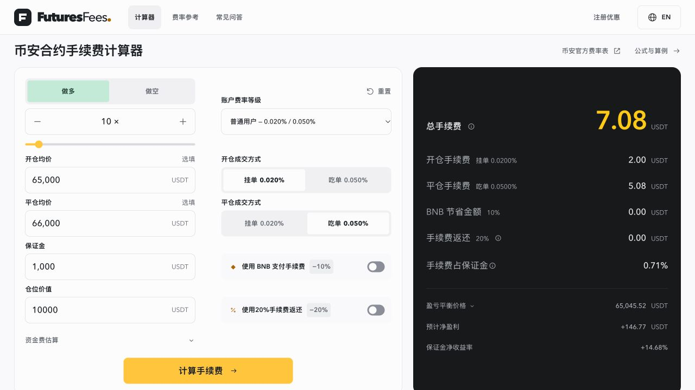

# FuturesFees — 币安合约手续费计算器

[English](README.md) · **简体中文**

合约手续费不能只看一个百分比，还要分清保证金、仓位价值，以及开仓和平仓各自的成交额。[FuturesFees 币安合约手续费计算器](https://futuresfees.com/zh/)是一个免费的网页工具，面向 USDT 本位线性永续合约，帮助你估算交易成本。

**[打开中文计算器 →](https://futuresfees.com/zh/)** · [English calculator](https://futuresfees.com/)

无需连接交易所账户或提供 API Key。FuturesFees 是独立第三方项目，非币安运营。本仓库提供产品介绍、实际界面截图和使用指南。

*截图使用假设输入，不代表实时行情或某个账户的实际费率。*

## 可以计算什么

- 分别选择开仓、平仓的 Maker / Taker 角色，估算两侧手续费。
- 支持单侧、开平仓往返，以及不填价格时的费用估算。
- 根据保证金和杠杆计算仓位价值，也可从仓位价值反算保证金。
- 使用参考费率预设，或填写自己账户的实际费率。
- 按需估算资金费，并对比符合条件的 BNB 支付和邀请返还情景。
- 填写开平仓价格后，查看净盈亏、保证金收益率和盈亏平衡价格估算。

网站支持中文和英文。计算参数在浏览器本地处理；网站统计和访问日志的说明见[关于与隐私说明](https://futuresfees.com/zh/about.html)。

## 一个算例：平仓费为什么不一样

假设保证金 **1,000 USDT**、杠杆 **10 倍**、开仓均价 **65,000**、平仓均价 **66,000**；开仓 Maker 费率为 **0.020%**，平仓 Taker 费率为 **0.050%**，并关闭资金费、BNB 优惠和邀请返还。以下数字仅用于说明算法。

| 项目 | 计算方式 | 估算结果 |
| --- | --- | --- |
| 开仓仓位价值 | 1,000 × 10 | 10,000 USDT |
| 数量 | 10,000 ÷ 65,000 | 约 0.153846 |
| 开仓手续费 | 10,000 × 0.020% | 2.00 USDT |
| 平仓仓位价值 | (10,000 ÷ 65,000) × 66,000 | 约 10,153.85 USDT |
| 平仓手续费 | 平仓仓位价值 × 0.050% | 约 5.08 USDT |
| 手续费合计 | 开仓费 + 平仓费 | **约 7.08 USDT** |

平仓时数量相同，但价格变化使成交额发生变化，所以平仓费不能直接沿用开仓成交额。计算过程保留精度，展示结果时再四舍五入。完整推导见[开仓和平仓手续费计算指南](https://futuresfees.com/zh/guides/fees.html)。

## 怎么使用

1. 打开 [FuturesFees 中文计算器](https://futuresfees.com/zh/)，选择做多或做空。
2. 填写保证金或仓位价值，并设置杠杆。
3. 填写对应一侧或两侧的平均成交价格，分别选择成交角色和实际账户费率。
4. 只在适用时启用资金费、BNB 支付或邀请返还估算。
5. 查看费用拆分；填写两侧价格后，再比较净盈亏和盈亏平衡结果。

优先使用交易所账户显示的实际费率。网站预设是参考值，不是实时账户查询；挂单不保证按 Maker 成交。保证金、仓位和杠杆之间的关系，可阅读[杠杆与手续费说明](https://futuresfees.com/zh/guides/leverage.html)。

## 适用范围与说明

当前计算器专注 **USDT 本位线性永续合约**，不执行交易、不连接账户、不提供实时价格。不计算现货手续费、强平费用或滑点，也不能把这些公式直接套用到币本位反向合约或期权。

资金费与交易手续费分别计算。资金费情景估算使用固定的输入费率和开仓仓位价值，不能替代每次实际结算的账单。盈亏平衡价格不是强平价格，也不是行情预测；实际成交、账户条件与交易所精度处理可能使结果不同。

网站包含推广注册链接，维护者可能获得佣金。邀请返还的资格、比例和结算以交易所当时的规则为准，返还不一定是交易时立即减免。使用计算器无需注册。

合约交易存在损失风险。本指南只解释成本计算，不推荐交易或承诺收益。

## 继续了解

- [中文计算器](https://futuresfees.com/zh/)
- [英文计算器](https://futuresfees.com/)
- [计算方法](https://futuresfees.com/zh/methodology.html)
- [合约费用指南](https://futuresfees.com/zh/guides/)
- [关于与隐私说明](https://futuresfees.com/zh/about.html)

如果发现计算问题，可以在 GitHub Issue 中提供可复现的示例输入与预期结果。请勿提交账户密码、API Key 或私人账户记录。
